 

<h2 style="color:#d4af37; margin:4px 0 2px 0;">Rajat Sharma · @Argyrys</h2>

  <b>House Slytherin.</b> Keeper of the Code. Brewer of ambitious little ideas. 
  Sorcery studied: Kotlin, JavaScript, Python &amp; C#.

<h2 style="color:#d4af37;">🪄 The Apprentice's Tale</h2>

  Sorted into Slytherin, armed with a laptop and a deeply unreasonable amount of curiosity.
  I forge digital spells at the edge of Android, AI and the web — from an <b>AI health companion</b>
  brewed for SIH 2026 to <b>face-recognition charms</b> and <b>chatting enchantments</b>.
  When I'm not unmasking bugs, I'm plotting the next Grimoire to ship before the moon rises.

  <b style="color:#7fe3a8;">Currently conjuring:</b> Kotlin apps · intelligent systems · clean interfaces 
  <b style="color:#7fe3a8;">Known for:</b> turning “what if?” into “it's live” before the deadline

<h2 style="color:#d4af37;">⚔️ The Wand &amp; The Craft</h2>

Spells written in the following tongues — wand core: pure curiosity.

<h2 style="color:#d4af37;">🔮 The Oracle's Ledger</h2>

<i>The crystal ball refreshes itself. Patience, young wizard.</i>

<h2 style="color:#d4af37;">📚 The Grimoire Shelf</h2>

  🦉 <a href="https://github.com/Argyrys/health-companion" style="color:#7fe3a8;"><b>health-companion</b></a> — an AI health companion brewed for SIH 2026 <i>(Kotlin)</i> 
  🦉 <a href="https://github.com/Argyrys/Overall-Ability" style="color:#7fe3a8;"><b>Overall-Ability</b></a> — the newest spell, still warm from the forge <i>(Kotlin)</i> 
  🦉 <a href="https://github.com/Argyrys/Face-Recognition-System" style="color:#7fe3a8;"><b>Face-Recognition-System</b></a> — vision magic and curious algorithms <i>(Python)</i> 
  🦉 <a href="https://github.com/Argyrys/MovieVault" style="color:#7fe3a8;"><b>MovieVault</b></a> — a vault of cinema, neatly enchanted <i>(JavaScript)</i> 
  🦉 <a href="https://github.com/Argyrys/Chatting-App" style="color:#7fe3a8;"><b>Chatting-App</b></a> — conversations carried by invisible owls <i>(Kotlin)</i>

<h2 style="color:#d4af37;">🦉 Owl Post</h2>

Send a scroll by GitHub — the owls know the way.

🐍 Enter the Chamber of Secrets (click to open)

  

    <i>Ssss…</i> You speak Parseltongue? Then the chamber is yours.
    You found the hidden room where ambitious ideas are brewed after midnight.
    Now go forth — and build something the Sorting Hat will remember.
  

  
✦ “It is our choices that show what we truly are, far more than our abilities.” ✦

Forged with a wand, a little green fire, and far too much coffee. ✦

