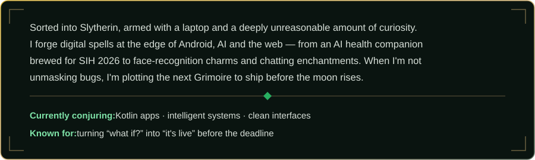
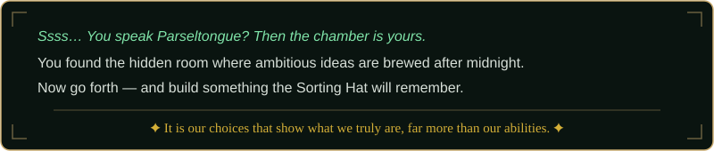

 

 

  

 

 

Spells written in the following tongues — wand core: pure curiosity.

 

 

The crystal ball refreshes itself. Patience, young wizard.

 

 
 
 
 

 

Send a scroll by GitHub — the owls know the way.

Forged with a wand, a little green fire, and far too much coffee. ✦

